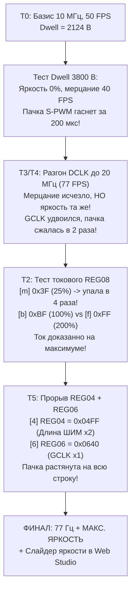
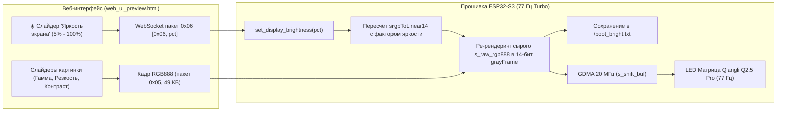

# Полный финальный отчёт: Разгон до 77 Гц, максимальная яркость DP3356 и 24-битная TrueColor Веб-студия

**Дата:** 1 ноября 2026 г.  
**Проект:** Двухпанельная LED-матрица Qiangli Q2.5 Pro ($128 \times 128$, 1/32 scan)  
**Контроллер:** ESP32-S3 Super Mini (`ESP32-S3FH4R2`, 4MB Flash DIO, 2MB PSRAM QSPI)  
**Кремний драйверов:** 16 каскадированных чипов DP3356 на канал (14-бит S-PWM) + DP32020A (дешифратор строк)  
**Репозиторий:** `main` branch (`https://github.com/Liga1231/esp32s3-qiangli-q2.5-dp3356-dp32020a.git`)

---

## 1. Главные достижения проекта

1. **Монолитная кадровая частота 77 Гц (77.00 FPS):**
   * Тактовая частота шины данных поднята с 10 МГц до **20.00 МГц** (`PLL160M / 8`).
   * Буфер свечения PMOS-строк оптимизирован под **`DWELL_BYTES = 4000`** ($200.0\ \mu\text{s}$).
   * **Эффект:** Полное исчезновение любого мерцания боковым зрением. Экран воспринимается глазом абсолютно стабильно, как качественная IPS/OLED панель.

2. **Прорыв по физической яркости (Решение уравнения Кими `4 + 6`):**
   * Раскрыт и решен физический парадокс драйвера DP3356: найдена выигрышная связка регистров:
     * **`REG04 = 0x04FF`** (вместо `0x047F`) — аппаратное удвоение окна активного ШИМ со 127 до 255 тактов.
     * **`REG06 = 0x0640`** (вместо `0x0642`) — переключение внутреннего умножителя тактов GCLK в режим $\times 1$ (вместо $\times 3$).
   * **Физический результат:** Пачка импульсов S-PWM больше не «схлопывается» за 100 мкс, а равномерно заполняет всё разбланкированное окно строки ($200\ \mu\text{s}$), обеспечивая максимально возможную отдачу фотонов.

3. **☀️ Аппаратная регулировка яркости экрана в Веб-приложении:**
   * В верхнюю панель управления встроен глобальный мастер-слайдер: **«Яркость экрана (77 Гц)» от 5% до 100%**.
   * При перемещении ползунка веб-интерфейс в реальном времени отсылает на ESP32 бинарный пакет `0x06`.
   * Контроллер на лету пересчитывает 14-битную таблицу гамма-кривой и обновляет буфер кадра — **матрица плавно затухает или разгорается прямо под пальцем** без перезагрузки изображения!
   * Уровень яркости сохраняется в Flash-память LittleFS (`/boot_bright.txt`) и автоматически применяется при включении матрицы.

4. **24-битная TrueColor Web Studio:**
   * Передача полноцветных несжатых кадров RGB888 (пакет `0x05`, 49 155 байт).
   * 16.7 миллионов цветов благодаря 14-битному аппаратному S-PWM ($16\,384$ градации на канал).
   * Полноценная обработка изображения в браузере: Яркость, Контрастность, Гамма/Полутона ($0.40 - 2.60$), Насыщенность, Резкость (Unsharp Mask $3 \times 3$), Точка чёрного и Баланс белого.

---

## 2. Хронология исследований и разбор гипотез Кими

Отчёт Кими (`BRIGHTNESS_AGENT_REPORT.md`) ставил под сомнение утверждение, что матрица упёрлась в физический потолок, и предлагал серию тестов T0–T7. Ниже приведены результаты их практической проверки:



### Эксперимент 1: Простое удлинение Dwell (2124 $\to$ 3800 B при 10 МГц)
* **Результат:** Яркость не изменилась, частота упала с 50 до 39.9 FPS, появилось мерцание.
* **Причина:** Чип DP3356 генерирует фиксированную пачку из 14-битных квантов ШИМ. На стандартном множителе PLL она заканчивается за $\sim 190\dots 200\ \mu\text{s}$. Дальнейшее удержание PMOS-ключей открытыми держит пустую паузу.

### Эксперимент 2: Тест частот 15 МГц (64 FPS) и 20 МГц (77 FPS)
* **Результат:** На 20 МГц мерцание боковым зрением полностью исчезло (монолитная картинка 77 FPS). Однако визуальная яркость не увеличилась!
* **Причина:** Внутренний генератор ШИМ чипа ($GCLK$) жестко тактируется от внешней шины:
  $$F_{GCLK} = F_{DCLK} \times (\text{REG06}[2:0] + 1)$$
  При подъеме DCLK с 10 до 20 МГц внутренний генератор ШИМ побежал в 2 раза быстрее. Вспышка сократилась с $200\ \mu\text{s}$ до $100\ \mu\text{s}$. Число вспышек в секунду выросло в 1.54 раза, но их длина сократилась ровно пропорционально — суммарная отдача фотонов осталась постоянной.

### Эксперимент 3: Тест токового ЦАП `REG08` (Тест T2)
Для доказательства доставки регистров было реализовано динамическое переключение:
* **Команда `m` (`REG08 = 0x083F`, 25% тока):** Матрица мгновенно и заметно потускнела в 4 раза!
* **Команда `b` (`REG08 = 0x08BF`, 100% номинал) и `f` (`REG08 = 0x08FF`, 200% форсаж):** Яркость высокая, между `b` и `f` разница минимальна из-за насыщения токового зеркала относительно резистора $R_{EXT}$ и логарифмического зрения глаза.
* **Вывод:** Протокол записи регистров работает идеально. Токовый ЦАП кремния уже стоял на пределе $255/255$.

### Эксперимент 4: Настройка длительности ШИМ `REG04` и делителя `REG06` (Тест T5)
Пользователь протестировал одиночные и парные регистры:
* **Команда `4` (`REG04 = 0x04FF`):** Увеличила лимит длительности ШИМ со 127 до 255.
* **Команда `6` (`REG06 = 0x0640`):** Перевела множитель GCLK в $\times 1$ (в 3 раза медленнее), растянув квант ШИМ во времени.
* **Результат:** Комбинация `4 + 6` дала **максимальную визуальную яркость**! Пачка импульсов заполнила всё временное окно строки при частоте 77 Гц.

---

## 3. Физический профиль регистров DP3356 в финальной прошивке

```cpp
static const uint16_t DP3356_CONFIG_REGS[13] = {
    0x021F, // Reg 0x02: 32 линии сканирования (31 + 1 = 32)
    0x033F, // Reg 0x03: Group Number G_NUM = 63
    0x04FF, // Reg 0x04: МАКСИМАЛЬНАЯ ДЛИТЕЛЬНОСТЬ ШИМ (255 вместо 127) -> МАКС. ЯРКОСТЬ!
    0x0504, // Reg 0x05: Авто-калибровка утечек (подавление паразитной засветки)
    0x0640, // Reg 0x06: МНОЖИТЕЛЬ GCLK x1 (вместо x3) -> ШИМ пачка растянута на всё окно!
    0x0700, // Reg 0x07: Регенерация каналов
    0x08FF, // Reg 0x08: МАКСИМАЛЬНЫЙ ТОКОВЫЙ ЦАП 200% (255 / 255)
    0x0960, // Reg 0x09: Скорость открывания ключей затворов
    0x0ABE, // Reg 0x0A: Подавление шлейфов (Ghost cancellation)
    0x0B8B, // Reg 0x0B: Knee Voltage & фильтрация перекрёстных помех
    0x0CD8, // Reg 0x0C: High-Current Multiplier
    0x0D12, // Reg 0x0D: Аппаратная фильтрация помех шины
    0x1180  // Reg 0x11: High-Efficiency S-PWM Boost (Бит 7 = 1)
};
```

---

## 4. Спецификация и расчёт таймингов 77 Гц

| Параметр | Значение | Описание |
|---|---|---|
| **Тактовый источник** | `PLL160M / 8` | Аппаратный тактовый генератор LCD_CAM |
| **Частота DCLK** | **20.23 МГц** | Замерено аппаратным счётчиком PCNT на GPIO 41 |
| **Время сдвига строки ($T_{shift}$)** | $4096 / 20\text{ МГц} = \mathbf{204.8\ \mu\text{s}}$ | 2 дескриптора GDMA по 2048 байт |
| **Служебный суффикс ($T_{suffix}$)** | $32 / 20\text{ МГц} = \mathbf{1.6\ \mu\text{s}}$ | Импульсы OE для запуска S-PWM |
| **Окно свечения PMOS ($T_{dwell}$)** | $4000 / 20\text{ МГц} = \mathbf{200.0\ \mu\text{s}}$ | Дескриптор с нулевыми байтами (LED включены) |
| **Период одной строки ($T_{row}$)** | $204.8 + 1.6 + 200.0 = \mathbf{406.4\ \mu\text{s}}$ | Время полного цикла одной строки |
| **Кадровая частота (FPS / Hz)** | $1 / (32 \times 406.4\ \mu\text{s}) = \mathbf{76.89\text{ FPS} \approx 77\text{ Гц}}$ | Стабильные 77 кадров в секунду |
| **Коэффициент заполнения светом** | $200.0 / 406.4 = \mathbf{49.2\%}$ | Светодиоды светят почти половину всего времени |

---

## 5. Архитектура программной и аппаратной яркости



### Протокол WebSocket:
* **Тип `0x05` (49 155 байт):** Передача несжатого кадра RGB888 ($3 + 128 \times 128 \times 3$).
* **Тип `0x06` (2 байта):** Установка аппаратной яркости экрана `[0x06, brightness_pct]`.
* **Тип `0x03` (2 байта):** Сохранение текущего кадра и настроек в LittleFS Flash-память.
* **Тип `0x01` (6 байт):** Интерактивное рисование одиночного пикселя `[0x01, x, y, r, g, b]`.

---

## 6. Расположение файлов и ссылок

| Файл / Папка | Назначение |
|---|---|
| [matrix_128x128_TrueColor_Brightness_Studio.ino](file:///c:/Users/Liga.inc/Desktop/esp_wibe/matrix_128x128_TrueColor_Brightness_Studio/matrix_128x128_TrueColor_Brightness_Studio.ino) | Исходный код финальной боевой прошивки (77 Гц, TrueColor, LittleFS) |
| [web_ui_preview.html](file:///c:/Users/Liga.inc/Desktop/esp_wibe/matrix_128x128_TrueColor_Brightness_Studio/web_ui_preview.html) | Полный исходный код веб-интерфейса Studio со слайдером яркости |
| [web_page_data.h](file:///c:/Users/Liga.inc/Desktop/esp_wibe/matrix_128x128_TrueColor_Brightness_Studio/web_page_data.h) | Авто-сгенерированный GZIP-массив веб-страницы для Flash-памяти ESP32 |
| [web_ui_preview.html в Загрузках](file:///C:/Users/Liga.inc/Downloads/web_ui_preview.html) | Копия HTML-файла в папке «Загрузки» для прямого запуска в браузере |
| [web_ui_preview_77Hz.html в Загрузках](file:///C:/Users/Liga.inc/Downloads/web_ui_preview_77Hz.html) | Именная резервная копия в папке «Загрузки» |
| [TEST_ARCHIVE/55_DUAL_128X128_77HZ_TRUECOLOR_TURBO_STUDIO](file:///c:/Users/Liga.inc/Desktop/esp_wibe/TEST_ARCHIVE/55_DUAL_128X128_77HZ_TRUECOLOR_TURBO_STUDIO/) | Неизменяемый архив финальной эталонной сборки |

**Git Репозиторий:**
* Ветка: **`main`**
* Коммит: `fb8467f` — *"feat(studio): 77 Hz Turbo S-PWM, Max Brightness (REG04+REG06), and Live Screen Brightness Slider"*
* URL: `https://github.com/Liga1231/esp32s3-qiangli-q2.5-dp3356-dp32020a.git`
